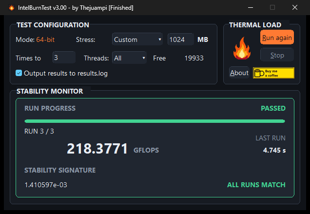
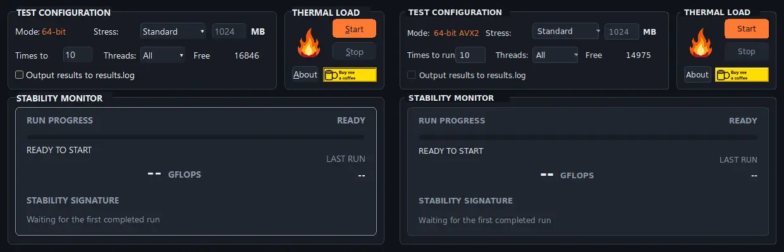
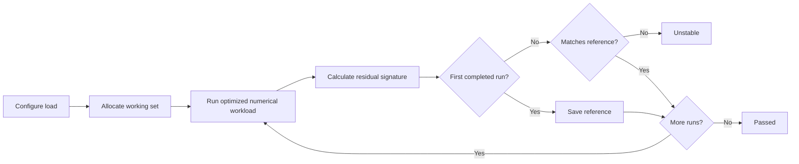
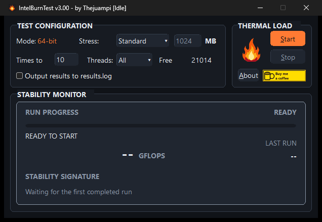
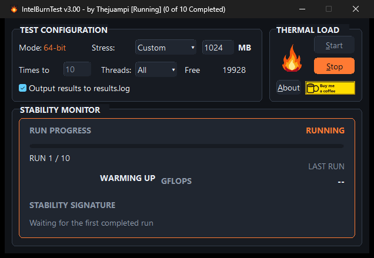

<div align="center">

# IntelBurnTest ASM

**An x86-64 CPU stability test written entirely in assembly and tuned for modern Intel processors.**

[Download USB v3.2.0](https://github.com/Thejuampi/ibt-asm/releases/download/v3.2.0/IntelBurnTest-USB-Setup.exe) · [Download Windows v3.3.0](https://github.com/Thejuampi/ibt-asm/releases/download/v3.3.0/IntelBurnTest.exe) · [Download Linux x64](https://github.com/Thejuampi/ibt-asm/releases/download/v3.3.0/IntelBurnTest-linux-x64) · [USB release notes](https://github.com/Thejuampi/ibt-asm/releases/tag/v3.2.0) · [Website](https://thejuampi.github.io/ibt-asm/) · [Build from source](#build-from-source)

</div>



IntelBurnTest applies a sustained numerical workload across the selected threads and memory footprint. After every completed run, it compares the residual signature with the previous results. Matching signatures indicate repeatable computation under load; a mismatch indicates instability.

The numerical workload, matrix kernels, thread workers, test orchestration, runtime ISA selection, validation, platform-native interfaces, and optional logging are all implemented in this codebase.

| | |
|---|---|
| **Purpose** | Detect CPU instability under sustained numerical load |
| **Primary target** | Modern Intel x86-64 processors |
| **Execution paths** | SSE2, AVX, and AVX2 selected automatically |
| **Platform** | Windows 10 or 11, x64; Linux x86-64 with X11; bootable x64 UEFI |
| **Runtime dependencies** | Windows system libraries; X11/Xft and glibc on Linux; firmware services in the OS-free UEFI port |
| **Persistent output** | Optional `results.log` on desktop; USB results stay in memory |

Windows (left) and Linux/X11 (right) use the same client geometry and visual
assets. ISA and available-memory values are detected independently on each host.



> [!WARNING]
> IntelBurnTest intentionally creates sustained high CPU load, power draw, and heat. Use adequate cooling, monitor temperatures, and stop the test if the system exceeds safe operating limits. A stability test can reveal failures under its workload; it cannot guarantee stability under every possible workload.

## Quick start

1. [Download `IntelBurnTest.exe`](https://github.com/Thejuampi/ibt-asm/releases/download/v3.3.0/IntelBurnTest.exe).
2. Close unnecessary applications and start temperature monitoring.
3. Choose a stress level, run count, and thread count.
4. Enable `results.log` only if you want a persistent record.
5. Select **Start** and watch the Stability Monitor.
6. Treat the test as passed only after every requested run completes with matching residual signatures.

For Linux x86-64 with X11, download
[`IntelBurnTest-linux-x64`](https://github.com/Thejuampi/ibt-asm/releases/download/v3.3.0/IntelBurnTest-linux-x64),
run `chmod +x IntelBurnTest-linux-x64`, then `./IntelBurnTest-linux-x64`.
The Linux executable requires glibc, X11, and Xft at runtime.

The v3.3.0 Windows executable is unsigned, so Windows SmartScreen may display a warning on first launch.

```text
Windows: IntelBurnTest.exe        98,304 bytes
SHA-256: 4784049ca4831ca3d68af5aa90e1abd694dd3dbe1ad7c8fcf5190ea0ad70edc4
Linux:   IntelBurnTest-linux-x64 172,008 bytes
SHA-256: e4b1b2e2aebd3aca781c2c4b9431f4a3e41a82bf030d604683556f146c078820
```

## How stability is determined



The first completed run establishes the reference residual. Each later run must produce the same signature. GFLOPS and elapsed time describe performance; the residual comparison determines consistency.

### Overlap runs

**Overlap runs (~2× memory)** is off by default. When enabled, a double buffer
lets the next LU solve start while the previous result's full residual is
checked in the background. Only one LU factorization runs at a time. The selected
thread count includes resolution, validation and buffer preparation; there is no
arithmetic filler. The option requires at least three threads and two runs.

With overlap enabled, every completed solve must have a finite normalized residual no greater than 16.
Both the raw and normalized residual must also match the session reference bit
for bit. A cancelled, incomplete, or numerically failed session cannot pass.
The desktop result says **NO NUMERICAL ERRORS**, meaning only the completed test.

For Standard, High, Very High and Custom, enabling the option keeps the selected
matrix dimension and uses about twice the RAM. The MB setting describes one
problem, not the aggregate allocation.
For example, 2048 MB keeps N=16384: numerical buffers use about 2.10 GiB normally
and 4.20 GiB with overlap and 20 total threads, excluding application/OS overhead
and thread stacks. Maximum accounts for both buffers and their working memory.

In both modes, displayed GFLOPS is estimated LU work divided by that solve's
factorization-and-solve time, as in the release baseline. A result is published
only after validation. A failed check stops all computation; incomplete or
unvalidated solves never count as passed.

Overlap removes the wait for the previous residual between solves. CPU load
and package power can still vary within a solve and during final validation;
the option does not promise constant watts.

## Choosing a stress level

| Level | Working set | Typical use |
|---|---:|---|
| **Standard** | 1,024 MB | Initial check and quick iteration |
| **High** | 2,048 MB | Heavier CPU and memory pressure |
| **Very High** | 4,096 MB | Longer tuning and thermal checks |
| **Maximum** | Fits all numerical buffers within available memory minus 256 MB | Highest available memory pressure; the system may become unresponsive |
| **Custom** | User-selected | Repeatable testing with an exact memory footprint |

Suggested starting points:

| Scenario | Stress | Runs | Threads | Logging |
|---|---|---:|---|---|
| Quick functional check | Standard | 3 | All | Off |
| CPU tuning iteration | High | 10 | All | On |
| Extended stability run | Very High | 20 or more | All | On |
| Thread-count investigation | Custom | 10 | Selected count | On |

These are examples, not universal pass criteria. Increase duration and memory pressure gradually while watching temperatures, clock behavior, and system responsiveness.

## Reading the Stability Monitor

<table>
  <tr>
    <td align="center"><br><strong>Ready</strong><br>Configure the workload before starting.</td>
    <td align="center"><br><strong>Running</strong><br>Progress and current workload state.</td>
  </tr>
</table>

| State | Meaning |
|---|---|
| **Ready** | No workload is running. |
| **Warming up** | Test data and the first numerical run are being prepared. |
| **Running** | The requested workload is active; no final verdict is available yet. |
| **Passed** | Every requested run completed and the residual signatures matched. |
| **Failure** | A numerical mismatch or unexpected termination was detected. |
| **Stopped** | The user interrupted the test; this is not a stability verdict. |

## Technical design

- CPU test code written in x86-64 NASM assembly; the separate Windows USB preparation utility uses C# and Windows storage APIs.
- Numerical workload and optimized matrix kernels run in-process.
- SSE2, AVX, and AVX2 capabilities are detected at startup; the best supported path is selected automatically.
- Benchmark data remains in memory during execution.
- No Intel LINPACK executable, MKL, or .NET dependency; the Linux frontend links glibc, X11, and Xft.
- No configuration or theme files are read at startup.
- `results.log` is created only when logging is enabled.
- Both frontends use the same in-process numerical assembly sources.
- Windows and X11 share the same 620 x 400 layout, control geometry, visual assets, and run-state presentation.
- The Windows release and Unix distributable are each a single native x86-64 executable.

## Build from source

### Windows requirements

- Windows 10 or 11, x64
- [NASM](https://www.nasm.us/)
- GNU Make

Open a command prompt with NASM and GNU Make on `PATH`, change to the repository directory, and run:

```console
make
```

NASM writes the executable to `bin/IntelBurnTest.exe`; `make` verifies 53
numerical routines against fixed machine-code references and runs the numerical
and resource self-test. A failed check makes the build fail. The verifier
normalizes supported instruction encodings, NOPs, branch targets and symbol
addresses; see `reference/numerical/README.md` for its limits.
Running `make` again reuses the current executable when its inputs have not
changed. Use `make -B` to force a full rebuild.

The `ibt_dual_*`, `ibt_third_*`, and `ibt_verify_*` include files are part of
the source tree. When changing numerical labels or mutable numerical state,
update the corresponding symbol mappings and state declarations as well.

Useful targets:

```console
make selftest  # verify the routines and run the numerical self-test
make check     # verify the routines and run the numerical self-test
make check-verifier # test equivalent encodings and reject a changed routine
make check-gui # create the application window and verify its controls and assets
make clean
```

Tool paths can be overridden when necessary:

```console
make NASM=C:\tools\nasm.exe
```

### Linux/X11 build

The Unix frontend reproduces the Windows 620 x 400 client area, dark layout,
control geometry, original flame and coffee assets, run states, residual
comparison, and optional `results.log`. It includes
`ibt_lpk.inc` and `bench_lib.inc` directly rather than maintaining a second
calculation implementation.

Install NASM, GNU Make, glibc, and the X11 and Xft runtime libraries, then run:

```console
make
./unix/IntelBurnTest
```

NASM creates `unix/IntelBurnTest` directly and `make` runs its headless numerical
self-test and checks its X11 and Xft imports. `make check-gui` also opens and
checks the interface when an X11 display is available. The direct NASM output is
uncompressed; it does not retain the former 25 KiB packed-size limit. See
[`unix/README.md`](unix/README.md) for Unix-specific details.

### Bootable UEFI port

The standalone port boots from a FAT32 USB drive without loading an operating
system. It automatically selects SSE2, AVX, or AVX2+FMA and supports parallel
numerical execution through the firmware's multiprocessor services.

Build with Python, NASM, and LLVM's `lld-link`:

```console
python uefi/build.py
```

On Windows, download **IntelBurnTest-USB-Setup.exe** from the
[v3.2.0 release](https://github.com/Thejuampi/ibt-asm/releases/tag/v3.2.0), choose
your USB, and confirm installation. FAT32 USBs keep their existing files;
formatting requires a separate erase confirmation. Build the installer with
`python uefi/build.py --installer`.

Manual alternatives: copy `ibt-uefi-usb.zip` to a FAT32 USB partition, or write
`ibt-uefi.img` as a raw image. Boot the USB's UEFI entry.
The EFI binary is unsigned. See [`uefi/README.md`](uefi/README.md)
for boot instructions, ISA selection, firmware constraints, and emulator checks.

## Repository layout

```text
ibt.asm             Win64 entry point, state, resources, and shared definitions
ibt_macros.inc      zero-overhead helpers for readable Win64 procedures
ibt_ui.inc          window procedure and application behavior
ibt_theme.inc       custom-control and dark-interface drawing
ibt_lpk.inc         test orchestration and numerical routines
bench_lib.inc       optimized matrix kernels
res/                source and compiled graphical assets
tools/              asset generation, alignment checks, size reports, and QA
unix/               Linux/x86-64 X11 frontend, build, and size gate
uefi/               OS-free x64 UEFI frontend, USB installer, and boot tests
reference/c/        C equivalent of every assembly procedure (reading map)
```

Ordinary UI and control-flow routines use `PROC_FRAME name, stack, saved...` with `ENDPROC` or `ENDPROC_SAVED` so the Win64 frame contract remains visible. Simple bottom-tested loops use `DO` / `WHILE jcc`; numerical kernels remain direct instructions and labels.

## Frequently asked questions

### Does a high GFLOPS result mean the system is stable?

No. GFLOPS measures throughput. Stability is determined by completing the requested runs with matching residual signatures.

### Does a passed run guarantee complete system stability?

No single stress test can cover every instruction mix, workload, temperature, or power transient. Use IntelBurnTest as one strong signal alongside the real workloads that matter to your system.

### Does the application read or write files while testing?

The workload runs in memory. No configuration or theme files are read. The only optional persistent output is `results.log`, created when its checkbox is enabled.

### Why does the system become difficult to use at Maximum?

Maximum reserves nearly all currently available memory and drives the selected CPU threads continuously. This is expected; use a smaller stress level if you need the machine to remain responsive.

## Credits

IntelBurnTest v3.2.0 was created by **Thejuampi**. IntelBurnTest 2.54 was created by **AgentGOD**.

[Buy Thejuampi a coffee](https://buymeacoffee.com/thejuampi)

No license is granted unless a license file is added explicitly.
